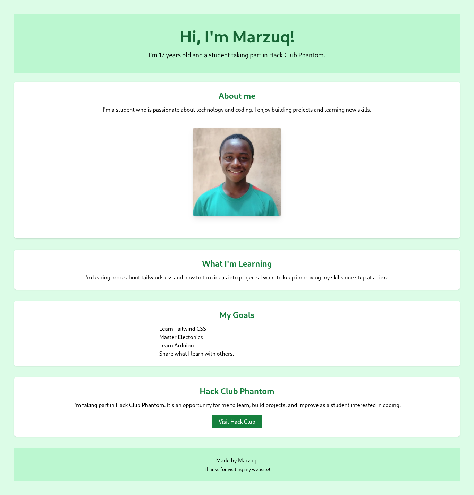

# my portfolio

a portfolio website built by marzuq, built with html and tailwind.

i included:

- a picture of me
- a bit about me and what i like

# Motivation

my motivation is i want to learn,relearn,unlern and share what ever i learnt with others.This what makes me built this project to practice frontend development and explore how HTML and Tailwind CSS work together to create a personal portfolio website.

# Development

1. Clone the repository:

```bash
git clone https://github.com/ranocodes/my-portfolio.git

cd Simple-Portfolio
```

2. Open index.html in your browser to view the website.

Here is the screenshoot of my site:


